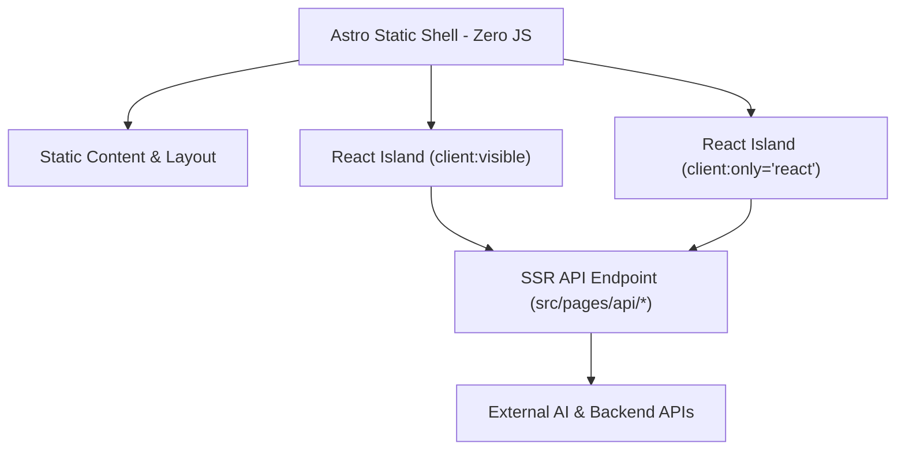

# AGENTS.md — AI Greener Operational Guide

> **Primary Operational Guide** for AI Agents and automated tools working on the **AI Greener** repository.

---

## 1. Project Identity

- **What is AI Greener**: A living laboratory where lightweight AI and web experiments grow. It combines a personal portfolio, an educational interactive lab, and a technical blog.
- **Philosophy**: *'Where lightweight AI experiments grow'* (AI + Green + -er). Each experiment makes complex technology "greener" — fresher, more accessible, lighter, and easier to digest. Every micro-app is designed as a self-contained island that teaches one concept well.
- **Author**: Lukasz Zatyka (GitHub: [lukassso](https://github.com/lukassso))
- **Domain**: [aigreener.com](https://aigreener.com), deployed on Netlify.

---

## 2. Architecture Overview

### Framework & Rendering Strategy
- **Framework**: Astro 4.x operating in hybrid rendering mode (`output: 'hybrid'`).
- **Static Shell (SSG)**: Content pages, landing pages, and blog posts are statically rendered ahead of time for ultra-fast loading and SEO.
- **Dynamic API Endpoints (SSR)**: Dynamic functionality and proxy endpoints run on serverless functions via Netlify Functions (`src/pages/api/`).

### React Islands Pattern
Interactive micro-apps operate as isolated React component trees (Islands) embedded inside zero-JavaScript Astro static pages. Islands hydrate on demand based on visibility or user interaction.

### Key Directories

- [`src/pages/`](file:///c:/Users/startrek/Desktop/Programming/Projects/!Astro%20projects/astro-trek/src/pages/) — Astro file-based routing (SSG pages + SSR API endpoints in `src/pages/api/`)
- [`src/features/`](file:///c:/Users/startrek/Desktop/Programming/Projects/!Astro%20projects/astro-trek/src/features/) — Self-contained React micro-apps (each feature represents one experiment)
- [`src/components/ui/`](file:///c:/Users/startrek/Desktop/Programming/Projects/!Astro%20projects/astro-trek/src/components/ui/) — 25 Shadcn/Radix UI primitives (shared across all experiments)
- [`src/components/`](file:///c:/Users/startrek/Desktop/Programming/Projects/!Astro%20projects/astro-trek/src/components/) — Astro and React components organized by domain (`blog/`, `common/`, `home/`, `portfolio/`)
- [`src/content/`](file:///c:/Users/startrek/Desktop/Programming/Projects/!Astro%20projects/astro-trek/src/content/) — Astro Content Collections for blog posts (MDX, en/pl)
- [`src/config/`](file:///c:/Users/startrek/Desktop/Programming/Projects/!Astro%20projects/astro-trek/src/config/) — SEO configuration (`pages.ts`, `seo.ts`)
- [`src/site.config.ts`](file:///c:/Users/startrek/Desktop/Programming/Projects/!Astro%20projects/astro-trek/src/site.config.ts) — Portfolio items registry and main menu links
- [`src/layouts/`](file:///c:/Users/startrek/Desktop/Programming/Projects/!Astro%20projects/astro-trek/src/layouts/) — Page layouts (`PageLayout.astro`, `PostLayout.astro`)
- [`src/firebase/`](file:///c:/Users/startrek/Desktop/Programming/Projects/!Astro%20projects/astro-trek/src/firebase/) — Firebase client (`client.ts`) and server (`server.ts`) SDK setup
- [`src/supabase/`](file:///c:/Users/startrek/Desktop/Programming/Projects/!Astro%20projects/astro-trek/src/supabase/) — Supabase client SDK setup
- [`docs/`](file:///c:/Users/startrek/Desktop/Programming/Projects/!Astro%20projects/astro-trek/docs/) — Project knowledge base (vision, architecture, roadmap, experiments registry)

---

## 3. Conventions & Rules

### 3.1 Astro Islands Hydration
- Use `client:visible` for below-the-fold interactive components (default choice to minimize initial JavaScript).
- Use `client:load` ONLY when the component must be interactive immediately on initial page load.
- Use `client:only="react"` for components that cannot render on the server (e.g., webcam streams, HTML5 canvas, browser-only APIs).
- **NEVER** use `react-router-dom` inside islands. All routing is handled strictly by Astro's file-based routing in [`src/pages/`](file:///c:/Users/startrek/Desktop/Programming/Projects/!Astro%20projects/astro-trek/src/pages/).

### 3.2 Dependency Discipline (Zero-Bloat Rule)
- **Date library**: `date-fns` only. Do **NOT** add `dayjs`, `moment`, or `luxon`.
- **Schema validation**: `zod` only. Do **NOT** add `yup`, `joi`, or `superstruct`.
- **State management**: Choose **ONE** per experiment. Allowed: React Query, Redux Toolkit, MobX, or Context API + `useReducer`. Document your choice in the experiment's folder.
- **Heavy libraries** (TensorFlow.js, Chart.js, OpenAI SDK): MUST use dynamic `import()` or `React.lazy()`. Never import heavy dependencies at the module top-level in client-side code.
- Before adding **ANY** new dependency, check if an existing package in `package.json` already covers the use case.

### 3.3 Security — Server-Side Only Keys
- All API requests requiring private secret keys (OpenAI, Supabase service keys, Firebase Admin, Movie API, Parsera) **MUST** go through serverless SSR endpoints in `src/pages/api/`.
- Client-side code may **ONLY** access environment variables prefixed with `PUBLIC_` (Astro convention).
- **NEVER** expose `OPENAI_API_KEY`, `SUPABASE_KEY`, `GEMINI_API_KEY`, `MOVIE_API_KEY`, or `PARSERA_API_KEY` inside React components or client scripts.
- Firebase Client SDK keys (`PUBLIC_FIREBASE_*`) are public by design and safe for client-side use.

### 3.4 TypeScript
- Strict mode is enabled (`noImplicitAny: true`).
- Path alias: `@/*` maps to `src/*`.
- All new code must be fully typed. Avoid using `any`.

### 3.5 Styling
- Tailwind CSS 3.4 with custom design tokens defined in `tailwind.config.ts` (using CSS custom properties like `--color-primary`, `--color-secondary`).
- Dark mode: class-based `[data-theme="dark"]`.
- Shared UI primitives stored in `src/components/ui/` (Shadcn pattern with `class-variance-authority` + `clsx` + `tailwind-merge`).
- Utility function for class merging: `cn()` from `src/utils/shadcn.ts`.

### 3.6 SEO
- Every new page **MUST** have an entry in `src/config/pages.ts` inside the `pagesData` record.
- The `generatePageSeo()` function automatically generates OpenGraph metadata.
- Blog posts use Astro Content Collections with Zod schemas defined in `src/content/config.ts`.

### 3.7 i18n
- Supported locales: `en` (default, no URL prefix) and `pl` (prefixed `/pl/`).
- Blog posts are organized by locale: `src/content/post/en/` and `src/content/post/pl/`.
- UI string translations reside in `src/i18n/`.

---

## 4. Adding a New Experiment (Checklist)

When creating a new micro-app / experiment:

- [ ] **1. Feature code**: Create `src/features/<experiment-name>/` containing all React components, hooks, stores, and types.
- [ ] **2. Astro page**: Create `src/pages/<experiment-name>.astro` importing the feature island and wrapping it in `PageLayout` with proper SEO meta.
- [ ] **3. SEO registration**: Add entry to `pagesData` in `src/config/pages.ts`.
- [ ] **4. Portfolio registration**: Add entry to `portfolioItems` in `src/site.config.ts` (`title`, `description`, `technologies`, `imageUrl`, `path`).
- [ ] **5. Experiment docs**: Add entry to `docs/experiments/README.md`.
- [ ] **6. API endpoints** (if needed): Create in `src/pages/api/<endpoint-name>.ts` — never handle private secret keys client-side.
- [ ] **7. Dependencies**: Follow the zero-bloat rule. Use dynamic imports (`import()`) for heavy packages.

---

## 5. Tech Stack Reference

| Layer | Technology |
| :--- | :--- |
| **Meta-framework** | Astro 4.x (hybrid SSG+SSR) |
| **UI Framework** | React 18 |
| **Styling** | Tailwind CSS 3.4 + Shadcn / Radix UI |
| **Blog** | Astro Content Collections (MDX) |
| **AI / ML** | TensorFlow.js, OpenAI SDK, `@ai-sdk/react` |
| **Data Fetching** | React Query (TanStack) |
| **Auth** | Firebase Auth + Firebase Admin SDK |
| **Database** | Supabase |
| **Deployment** | Netlify (SSG + Serverless Functions) |
| **Code Quality** | TypeScript (strict), ESLint, Prettier |
| **Testing** | Playwright (E2E) |

---

## 6. Further Reading

- [docs/vision.md](file:///c:/Users/startrek/Desktop/Programming/Projects/!Astro%20projects/astro-trek/docs/vision.md) — Brand manifest and philosophy
- [docs/architecture.md](file:///c:/Users/startrek/Desktop/Programming/Projects/!Astro%20projects/astro-trek/docs/architecture.md) — Detailed technical architecture
- [docs/experiments/README.md](file:///c:/Users/startrek/Desktop/Programming/Projects/!Astro%20projects/astro-trek/docs/experiments/README.md) — Registry of all experiments
- [docs/roadmap.md](file:///c:/Users/startrek/Desktop/Programming/Projects/!Astro%20projects/astro-trek/docs/roadmap.md) — Development roadmap
