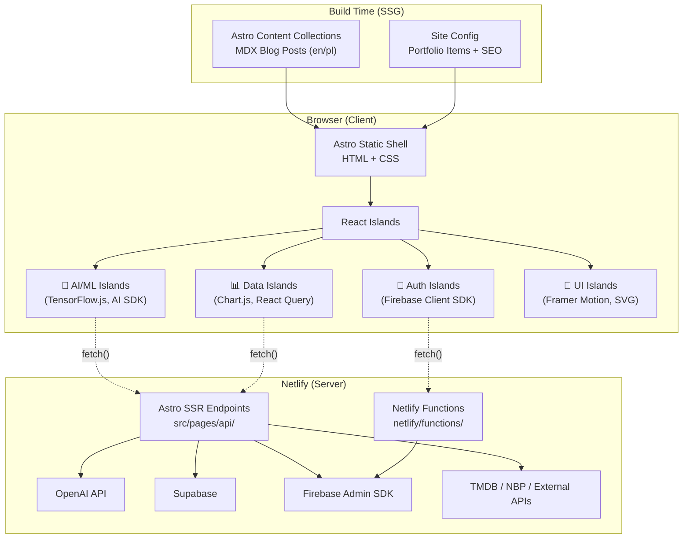

# AI Greener — Technical Architecture

## System Overview

AI Greener is built on **Astro 4.x** in **hybrid mode** (`output: 'hybrid'`), deployed on **Netlify**. This architecture separates concerns cleanly:

- **Static Generation (SSG)**: Blog posts, landing page, portfolio cards — pre-rendered at build time for maximum performance
- **Server-Side Rendering (SSR)**: API endpoints in `src/pages/api/` run as Netlify Serverless Functions, handling private API keys and server-side logic
- **Client-Side Islands**: React 18 components hydrated selectively via Astro's Islands architecture

---

## High-Level Architecture



---

## Directory Structure

```
astro-trek/
├── AGENTS.md                          # AI agent operational guide
├── astro.config.ts                    # Astro config (hybrid, Netlify adapter, integrations)
├── tailwind.config.ts                 # Tailwind 3.4 + custom design tokens
├── tsconfig.json                      # TypeScript strict mode, path aliases
├── netlify.toml                       # Netlify build config + API redirects
├── components.json                    # Shadcn UI configuration
├── docs/                              # Project knowledge base
│   ├── vision.md                      # Brand manifest
│   ├── architecture.md                # This file
│   ├── roadmap.md                     # Development roadmap
│   └── experiments/
│       └── README.md                  # Experiment registry
├── netlify/
│   └── functions/                     # Netlify serverless functions (auth)
├── public/                            # Static assets (favicons, images, manifest)
└── src/
    ├── pages/                         # Astro file-based routing
    │   ├── index.astro                # Homepage (Hero + TechStack + Clients + Portfolio)
    │   ├── blog/                      # Blog listing and post pages
    │   ├── pl/                        # Polish locale pages
    │   ├── api/                       # SSR endpoints (OpenAI, movies, scraper, auth)
    │   ├── dashboards/                # Dashboard sub-pages
    │   ├── firebase-auth/             # Auth flow pages
    │   ├── movie-app/                 # Movie app sub-pages
    │   ├── nbp-currency-explorer/     # Currency explorer sub-pages
    │   └── *.astro                    # Individual experiment pages
    ├── features/                      # Self-contained React micro-apps
    │   ├── dashboards/                # bank-transactions, playground-ai
    │   ├── hacker-news/
    │   ├── movie-app/
    │   ├── nbp-currency-explorer/
    │   ├── rag-assistant/
    │   ├── task-manager/
    │   ├── webcam-object-detection/
    │   └── webcam-pose-detection/
    ├── components/
    │   ├── ui/                        # 25 Shadcn/Radix primitives
    │   ├── common/                    # Header, Footer, ThemeProvider, etc.
    │   ├── home/                      # Hero, PortfolioSection, TechStack, Clients
    │   ├── blog/                      # Blog-specific components
    │   └── portfolio/                 # Portfolio card components
    ├── content/                       # Astro Content Collections
    │   ├── config.ts                  # Zod schemas for post and note collections
    │   ├── post/en/                   # English blog posts (MDX)
    │   └── post/pl/                   # Polish blog posts (MDX)
    ├── config/
    │   ├── seo.ts                     # Global SEO constants (SITE_URL, SITE_BRAND_NAME)
    │   └── pages.ts                   # Per-page SEO data + generatePageSeo()
    ├── layouts/
    │   ├── PageLayout.astro           # Main layout (head, header, footer, analytics)
    │   └── PostLayout.astro           # Blog post layout
    ├── styles/
    │   ├── index.css                  # Entry point
    │   ├── global.css                 # Global styles
    │   ├── theme.css                  # CSS custom properties for theming
    │   └── shadcn-ui.css              # Shadcn component styles
    ├── firebase/
    │   ├── client.ts                  # Firebase Client SDK init
    │   └── server.ts                  # Firebase Admin SDK init
    ├── supabase/
    │   └── client.ts                  # Supabase client init
    ├── hooks/                         # Custom React hooks
    ├── i18n/                          # Internationalization utilities
    ├── icons/                         # Icon components
    ├── utils/                         # Shared utilities
    ├── site.config.ts                 # Portfolio items + menu links + Expressive Code config
    ├── types.ts                       # Shared TypeScript types
    └── env.d.ts                       # Astro environment type declarations
```

---

## Experiment Registry

| # | Experiment | Category | Key Technologies | State Management | API Endpoint | Feature Path | Page Path |
|---|-----------|----------|-----------------|-----------------|-------------|-------------|----------|
| 1 | Object Detection | 🧠 AI/ML | TensorFlow.js, Coco-ssd, react-webcam | Local state | — | `features/webcam-object-detection/` | `/webcam-object-detection` |
| 2 | Pose Detection | 🧠 AI/ML | TensorFlow.js, Pose Detection model | Local state | — | `features/webcam-pose-detection/` | `/webcam-pose-detection` |
| 3 | Playground AI | 🧠 AI/ML | OpenAI SDK, @ai-sdk/react, Shadcn UI | Local state | `api/ask-open-ai.ts`, `api/openai.ts` | `features/dashboards/playground-ai/` | `/dashboards/playground-ai` |
| 4 | RAG Assistant | 🧠 AI/ML | Supabase, Gemini AI | Local state | `api/ask-titanic.ts`, `api/generate-idea.ts` | `features/rag-assistant/` | `/rag-assistant` |
| 5 | Currency Explorer | 📊 Data Viz | Chart.js, React Router, date-fns, SCSS | Local state | — (direct NBP API) | `features/nbp-currency-explorer/` | `/nbp-currency-explorer` |
| 6 | Movie App | 📊 Data Viz | React Query, React Router, Playwright | MobX | `api/movies-api.ts` | `features/movie-app/` | `/movie-app` |
| 7 | Bank Transactions | 📦 State Mgmt | React Hook Form, Yup, Radix UI | Context + useReducer | — | `features/dashboards/bank-transactions/` | `/dashboards/bank-transactions` |
| 8 | Task Manager | 📦 State Mgmt | Redux Toolkit, react-redux | Redux | — | `features/task-manager/` | `/task-manager` |
| 9 | Hacker News | 📦 State Mgmt | REST API, Tailwind CSS | Context + useReducer | — | `features/hacker-news/` | `/hacker-news` |
| 10 | Multi Select | 🎨 UI Component | cmdk, Radix UI, Tailwind CSS | Local state | — | — (inline) | `/multi-select` |
| 11 | SVG Anime Universe | 🎨 Animation | SVG API, CSS animations | Local state | — | — (inline) | `/svg-anime-universe` |
| 12 | Framer Parallax | 🎨 Animation | Framer Motion, Tailwind CSS | Local state | — | — (inline) | `/framer-parallax` |
| 13 | Firebase Auth | 🔐 Auth | Firebase Auth, React Hook Form, Zod | Local state | Netlify Functions (auth/) | — (in pages/) | `/firebase-auth/signin` |
| 14 | Random Person | 📊 Data Viz | react-icons, REST API | Local state | — (direct API) | — (inline) | `/random-person` |

> [!NOTE]
> URL Scraper (`/url-scraper`) exists as a page with `api/scrape.ts` endpoint but is not listed in `portfolioItems`.

---

## Data Flow Patterns

### Pattern 1: Static Island (No API)

Used by: SVG Anime Universe, Framer Parallax, Multi Select, Task Manager, Bank Transactions

```
Astro Page (SSG) → React Island (client:visible) → Local State
```

### Pattern 2: Direct External API

Used by: Currency Explorer (NBP API), Hacker News (HN API), Random Person (randomuser.me)

```
Astro Page (SSG) → React Island (client:visible) → fetch() → External Public API
```

### Pattern 3: Proxied API with Server Keys

Used by: Playground AI, RAG Assistant, Movie App, URL Scraper, Firebase Auth

```
Astro Page (SSG) → React Island → fetch('/api/...') → Astro SSR Endpoint → External API (with private key)
```

---

## Design System

### Theme Architecture

- CSS custom properties defined in `src/styles/theme.css`
- Tailwind config extends with semantic color tokens (`primary`, `secondary`, `bgcolor`, `brcolor`)
- Dark mode toggled via `[data-theme="dark"]` class on `<html>`
- Theme persistence handled by `ThemeProvider.astro`

### Component Library

25 Shadcn/Radix UI primitives in `src/components/ui/`:

Avatar, Badge, Button, Calendar, Card, CardSpring, Collapsible, Command, Dialog, Drawer, DropdownMenu, Input, Label, Pagination, Popover, Select, Separator, Sheet, Skeleton, Slider, Switch, Table, Tabs, Textarea, Tooltip

All follow the Shadcn pattern: `class-variance-authority` for variants + `cn()` utility for class merging.

---

## SEO Architecture

- Global SEO config in `src/config/seo.ts` (`SITE_URL`, `SITE_BRAND_NAME`, default OG image)
- Per-page SEO data in `src/config/pages.ts` — `pagesData` record with title, description, OG overrides
- `generatePageSeo()` auto-generates full OpenGraph metadata from page data
- `AstroSeo` component in `PageLayout.astro` merges global + page-level SEO
- JSON-LD structured data support via `jsonLd` prop in `PageLayout`
- Google Analytics (`G-WT44D67W36`) loaded in `PageLayout` head
- Sitemap generated by `@astrojs/sitemap`
- RSS feed at `/rss.xml`

---

## Deployment

- **Platform**: Netlify
- **Build command**: `astro build`
- **Publish directory**: `dist`
- **Node version**: 20.11.0
- **Serverless functions**: `netlify/functions/` (auth endpoints)
- **API redirects**: Configured in `netlify.toml` for auth endpoints
- **SSR endpoints**: Handled natively by Astro's Netlify adapter
